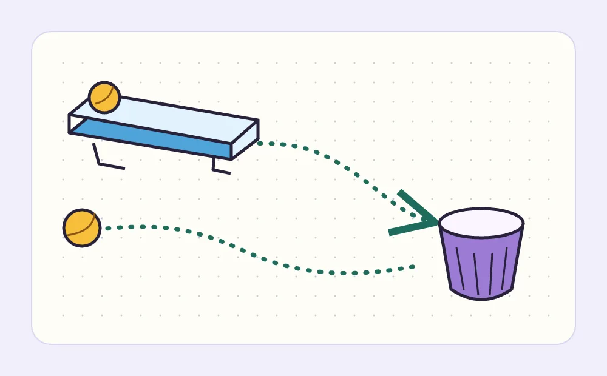

Cada 3 de diciembre se conmemora el Día Internacional de las Personas con Discapacidad. Puedes tomar esta fecha como punto de partida para revisar una situación concreta del aula. ¿Qué tendríamos que cambiar para que cada persona pueda jugar con el resto del grupo?

**Objetivo:** reconocer una barrera del juego y probar un cambio en el espacio, el material o la regla para ampliar la participación.

## Materiales y preparación

Reúne una pelota grande y blanda, una cesta de boca ancha y cinta removible para marcar dos posiciones. Si el grupo lo necesita, ofrece una canaleta ancha de cartón que puedas sujetar sobre una superficie estable. Deja espacio libre para acercarse y comprueba que la pelota no invade las zonas de paso.

## Cómo hacer la actividad

1. **Muestra la meta común.** Pon la cesta a poca distancia y explica que el reto consiste en llevar la pelota hasta ella. Haz una demostración. Ofrece comenzar desde el suelo o desde una mesa baja si ambas posiciones son accesibles para el grupo.
2. **Deja elegir en cada turno.** Se puede rodar la pelota, acercar la cesta o probar con la canaleta. Quien quiera puede señalar el camino y acordar con alguien cómo ponerlo en práctica. Puedes ofrecer opciones señalando los objetos.
3. **Escucha e incorpora una propuesta.** Pregunta qué ayudó y qué habría que mover. Si dos personas necesitan configuraciones distintas, prueben las dos. Pide permiso antes de tocar el cuerpo de alguien o mover su equipo de apoyo.
4. **Conserva el cambio.** Deja la regla acordada disponible para el próximo recreo. Puede ser «Elegimos desde dónde empezar» o «La cesta se mueve si lo necesitamos».

## Ajustes según la edad

- **3 años.** Modela dos formas de acercar la pelota. Deja que cada niña o niño indique cuál quiere probar mediante la mirada, el gesto o la palabra.
- **4 años.** Invita a una pareja a elegir la posición de la cesta y a revisar si el cambio le sirve a ambas personas.
- **5 años.** Propón comparar dos reglas y dictar al adulto una frase que explique cuándo elegir cada una.

## Qué observar

Anota quién pudo tomar una decisión, qué barrera mencionó o mostró el grupo y qué cambió en la participación después del ajuste. La distancia recorrida por la pelota puede variar en cada turno.

Puedes retomar el acuerdo con [juegos de patio](/juegos/juegos-de-patio/) y usar el [calendario de fechas especiales](/efemerides/calendario-fechas-especiales-educacion-inicial/) para ubicar la propuesta en tu planificación local.

La fecha y el enfoque de participación se apoyan en las [Naciones Unidas, Día Internacional de las Personas con Discapacidad](https://www.un.org/en/events/disabilitiesday/).
