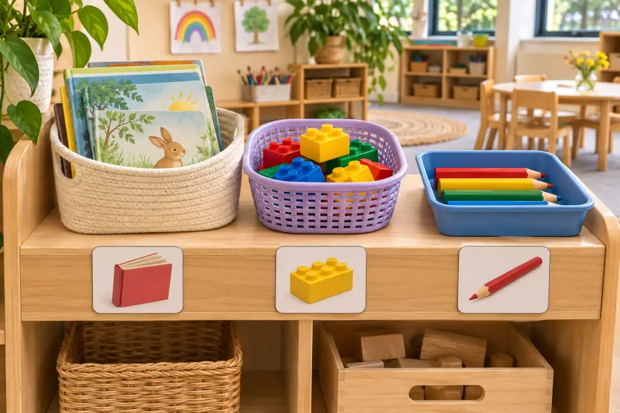

¿Cómo le mostrarías a otra persona dónde se guardan los lápices si acaba de llegar al aula? El grupo elige un lugar que use a diario, hace una señal y la prueba con alguien que no la dibujó. Así pueden revisar si la imagen ayuda a encontrar el material.

**Objetivo:** crear un mensaje visual fácil de reconocer y volver a diseñarlo según lo que otra persona entendió.

## Materiales

- Dos recipientes accesibles con materiales conocidos, por ejemplo, un recipiente de lápices y otro de bloques.
- Cartulina clara, marcadores de punta gruesa con buen contraste y cinta removible.
- Uno o dos ejemplos de señales con imágenes que ya existan en la escuela o dibujos sencillos que puedas mostrar.

## Cómo hacer la actividad

1. **Elige un problema cotidiano.** Junta sobre una mesa un lápiz y un bloque grande. Pregunta qué necesitaría ver una persona nueva para saber dónde va cada uno. Abran los recipientes y observen qué los distingue.
2. **Diseña una señal por recipiente.** Invita a elegir un dibujo sencillo y grande. Puedes trazar el contorno de un bloque o dibujar un lápiz que se parezca a los que usan. Si alguien propone una palabra, escríbela junto al dibujo y deja el pictograma visible.
3. **Prueba las señales.** Colócalas a la altura del grupo. Pide a otra pareja que guarde un objeto a partir de las imágenes. Pregunta qué la ayudó y si alguna parte le generó dudas.
4. **Cambia un detalle y vuelve a probar.** Tal vez haga falta agrandar el dibujo, acercar la señal al recipiente o cambiar un trazo. Haz una sola modificación y prueba otra vez. Dejen puesta la versión que el grupo pueda usar en su rutina.

## Ajustes según la edad

- **3 años.** Ofrece dos imágenes grandes ya dibujadas. Deja que el grupo elija cuál corresponde a cada material y llévala junto al recipiente.
- **4 años.** Invita a dibujar una señal en pareja y a comprobarla con otra. Puedes sostener el material real cerca para facilitar la comparación.
- **5 años.** Distribuye los roles de diseño y prueba. Pide que justifiquen el cambio que hicieron a partir de la respuesta de sus compañeros.

## Qué observar

Anota si alguien reconoce qué comunica la imagen, relaciona la señal con el recipiente correcto o propone un cambio después de observar una prueba. Registra también si el grupo usa las señales durante otro momento de la jornada.

Para decidir dónde conviene colocar los materiales, consulta [Sectores de juego en el aula](/blog/sectores-de-juego-en-el-aula/).

## Referencia para docentes

El currículo español de Educación Infantil incluye producir e interpretar mensajes con diferentes lenguajes. Aquí el dibujo funciona como mensaje para una tarea real dentro del aula. [Real Decreto 95/2022, anexo II](https://www.boe.es/buscar/act.php?id=BOE-A-2022-1654#ai-2)
