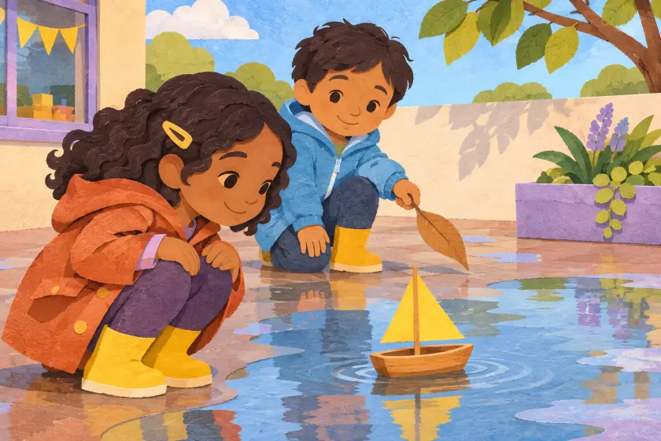

**Objetivo de lectura:** anticipar qué harán los personajes y reconstruir dos acciones del cuento con palabras, gestos o dibujos.

## El barco del charco

La lluvia se había ido del patio. En el suelo quedaban un charco ancho y el reflejo de una ventana.

Mara trajo un barco de madera con vela amarilla. Lo dejó en la orilla del charco. El barco dio una vuelta y se quedó quieto.

—Quiero que llegue al otro lado —dijo Mara.

Movió la mano en el aire, como si se despidiera de alguien. El barco giró un poquito. Después volvió a mirar hacia la ventana.

Julián se agachó junto a ella, sobre las baldosas secas. Tenía una hoja larga que había encontrado cerca de una maceta.

—Puedo tocar el barco con la punta —dijo.

La hoja se dobló apenas llegó al agua. Mara miró la hoja. Miró la vela. Entonces sostuvo las dos manos cerca de su boca.

—Ffff —sopló.

El barco avanzó despacio, con la vela un poco inclinada.

—Ahora soplo yo —dijo Julián.

Ffff. El barco chocó con una piedrita y quedó de costado.

—Desde aquí lo empujamos hacia la piedra —dijo Mara.

Los dos caminaron alrededor del charco por el piso seco. Desde el otro lado pudieron soplar hacia un espacio libre.

Ffff. Ffff.

La vela amarilla se enderezó. El barco pasó junto a la piedra y siguió hasta rozar la orilla.

Mara lo levantó. Julián puso su hoja en el agua. La hoja quedó al lado del reflejo de la ventana.

—Esta también sabe navegar —dijo él.

Mara se sentó en la baldosa. Esta vez esperó a ver hacia dónde iría.

## Cómo leerlo en el aula

Prepara un dibujo sencillo de un barco y una hoja grande de papel azul. Lee hasta que la hoja de Julián se doble y pregunta qué podrían probar después. Escucha un par de ideas y sigue la lectura. Al terminar, puedes mover el barco de papel por el dibujo para que el grupo recuerde qué ocurrió cuando se acercó a la piedra.

## Ajustes según el grupo

- **3 años.** Muestra el barco cuando aparezca y acompaña «ffff» con un gesto. Para reconstruir el final, ofrece dos imágenes y deja que señalen dónde llegó.
- **4 años.** Pide que representen con las manos la hoja que se dobló o el viento que movió el barco. Invítales a recordar qué pasó primero.
- **5 años.** Invita a explicar por qué los personajes cambiaron de lugar después de llegar a la piedra. Pueden dibujar otra forma de continuar la historia y contarla en pareja.

## Qué observar

Fíjate si alguien relaciona una acción con lo que pasó después. Puedes registrar «hace el gesto de soplar al ver el dibujo del barco» o «explica que rodearon el charco para moverlo hacia el espacio libre». Ofrece el dibujo como apoyo para quien lo necesite.

Si quieres acompañar la lectura con otras preguntas y apoyos visuales, consulta la [secuencia de lectura compartida](/planificaciones/secuencia-lectura-compartida-preescolar/). [La nube Pipa](/cuentos/cuento-la-nube-pipa/) propone otra lectura relacionada con lo que se observa después de la lluvia.

## Referencia para docentes

El cuento es original de Salainicial. Las propuestas para reconstruir el relato a partir de imágenes se apoyan en las orientaciones de Educ.ar para conversar sobre quiénes participan y qué ocurrió. [Estrategias para ejercitar la lengua oral en Nivel Inicial](https://cdn.educ.ar/dinamico/UnidadHtml__get__dd650098-7a08-11e1-826f-ed15e3c494af/index.html)
