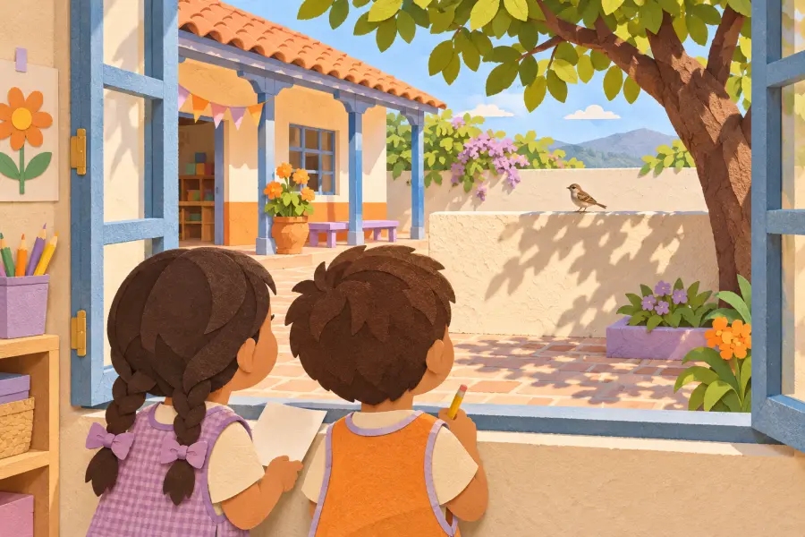

**Objetivo de lectura:** recuperar un detalle que observó cada personaje y conversar sobre cómo dos miradas se pueden complementar.

## El pájaro que volvió al muro

Desde la ventana del aula, Nora vio un pájaro saltar por el borde del muro. Dio dos saltos cortos y luego desapareció detrás de unas hojas.

—Tenía una cola larga —le dijo a Teo.

Teo se quedó junto a ella. Pasó una sombra de rama sobre el muro. El pájaro no salió.

Nora dibujó una línea larga en el papel.

—Aquí va la cola.

Teo miró el dibujo. Después miró el muro.

—Yo todavía no vi la cola —dijo.

Pasó un rato. Cuando volvió a moverse la rama, un pájaro se posó en el mismo borde. Teo alcanzó a ver sus patas y la forma en que se agarraban al muro.

—Dos patas delgadas —dijo muy bajito.

Nora miró, pero el pájaro levantó vuelo antes de que pudiera verlas.

Teo dibujó dos rayas a un lado de la hoja. Nora puso el papel entre los dos.

—¿Volvió el mismo pájaro? —preguntó Teo.

—Puede ser. ¿Miramos otra vez cuando venga alguno?

Dejaron el dibujo junto a la ventana. Tenía una cola, dos patas y un espacio grande en el medio.

En una esquina, Nora hizo un dibujo pequeño del muro. Así podrían recordar dónde volver a mirar.

## Cómo leerlo en el aula

Muestra la ilustración o dibuja un muro sencillo en un papel. Pausa cuando Teo diga que vio las patas. Pregunta qué había mirado Nora y qué sabe Teo. Después de leer, deja que el grupo agregue al dibujo una marca para recordar cada detalle.

## Ajustes según la edad

- **3 años.** Acompaña «cola» y «patas» con un gesto o dos imágenes grandes. Acepta que señalen o representen un salto.
- **4 años.** Pide que cada pareja elija un detalle y lo relacione con uno de los personajes. Pueden mostrarlo con el dibujo y dictar una frase.
- **5 años.** Pregunta qué podrían mirar otra vez para saber si era el mismo pájaro y qué preguntas quedarían abiertas. Deja que hagan un dibujo con pistas posibles.

## Qué observar

Registra si alguien recupera un detalle del relato, lo atribuye a la persona que lo vio o diferencia una idea de algo que el texto sí cuenta. Puedes usar lo que señalan o representan con el cuerpo como parte del registro.

Si quieres extender la conversación a otras historias, consulta la [secuencia de lectura compartida](/planificaciones/secuencia-lectura-compartida-preescolar/). Para llevar la curiosidad al exterior, prueba el [Bingo de la naturaleza](/fichas/bingo-de-la-naturaleza/).

## Referencia para docentes

El cuento es original de Salainicial. Las pausas para recuperar personajes y detalles se apoyan en las orientaciones de Educ.ar sobre narración oral con imágenes. [Estrategias para ejercitar la lengua oral en Nivel Inicial](https://cdn.educ.ar/dinamico/UnidadHtml__get__dd650098-7a08-11e1-826f-ed15e3c494af/index.html)
