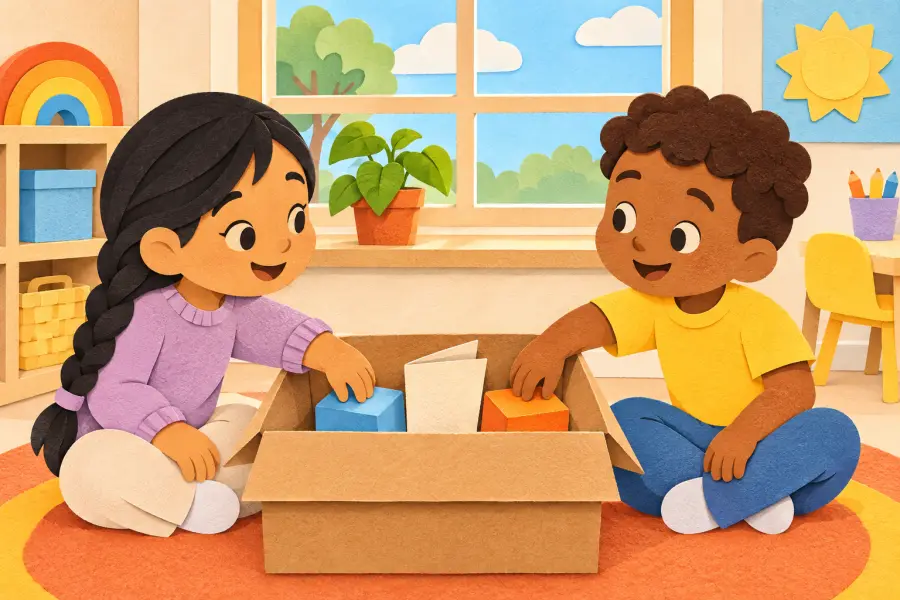

**Objetivo de lectura:** reconocer qué necesitan dos personajes y reconstruir cómo encuentran una solución juntos.

## La caja de la ventana

El sol dibujó un cuadrado en el suelo del aula. Lila acercó su papel al cuadrado y levantó una caja de cartón.

—Aquí veo mejor los colores —dijo.

En la caja había un bloque azul, otro amarillo y algunas tiras de papel. Del otro lado, Simón estiró la mano para tomar una tira. La caja quedó tan cerca de la rodilla de Lila que Simón no llegaba.

—¿Me pasas la caja?

Lila se la acercó. Simón tomó una tira, pero ahora Lila se quedó con el lápiz en la mano y el bloque azul lejos.

Volvieron a pasar la caja. Una esquina del papel se dobló debajo.

—La caja viaja mucho —dijo Simón.

Lila miró el cuadrado de sol y después el espacio entre los dos. Puso la caja en el medio.

—A ver desde aquí.

Simón pudo tocar las tiras. Lila pudo tomar el bloque azul. Los dos movieron un poco sus papeles para dejar sitio.

—Mi dibujo quiere una ventana —dijo Lila.

—Y el mío una puerta —dijo Simón.

Usaron el mismo bloque azul, primero sobre un papel y después sobre el otro. Siguieron sus bordes con el lápiz. Cuando lo levantaron, había una ventana y una puerta casi del mismo tamaño.

Al final, juntaron los dos dibujos junto al cuadrado de luz. Ahora parecía una sola casa con espacio para entrar y mirar afuera.

## Cómo leerlo en el aula

Ten a mano una caja abierta y dos hojas grandes. Cuando Simón pide la caja, pausa y pregunta «¿quién puede alcanzarla ahora?». Al terminar, representa los tres lugares donde quedó y deja que el grupo señale el que funcionó para ambos.

## Ajustes según el grupo

- **3 años.** Usa la caja real y dos dibujos que representen a cada personaje. Deja que señalen dónde pueden alcanzarla ambos mientras tú recuerdas qué pasó.
- **4 años.** Da una tira de papel a cada pareja para representar la escena. Pide que muestren o cuenten dónde estaba la caja al principio y dónde terminó.
- **5 años.** Invita a pensar otra solución si se suma una tercera persona. Pide que expliquen cómo sabrían si todas pueden elegir un material.

## Qué observar

Registra si alguien señala cuál personaje queda lejos, propone un lugar al alcance de ambos o reconstruye el cambio de posición. Ofrece la caja como apoyo a quien quiera mostrar la respuesta con un movimiento.

Para preparar el espacio de juego después de la lectura, consulta [Sectores de juego en el aula](/blog/sectores-de-juego-en-el-aula/). También puedes continuar con [La biblioteca del patio](/cuentos/cuento-la-biblioteca-del-patio/) para conversar sobre materiales compartidos.

## Referencia para docentes

El cuento es original de Salainicial. La pausa para conversar sobre qué les pasa a los personajes y cómo continúa la historia retoma orientaciones de narración oral de Educ.ar. [Estrategias para ejercitar la lengua oral en Nivel Inicial](https://cdn.educ.ar/dinamico/UnidadHtml__get__dd650098-7a08-11e1-826f-ed15e3c494af/index.html)
