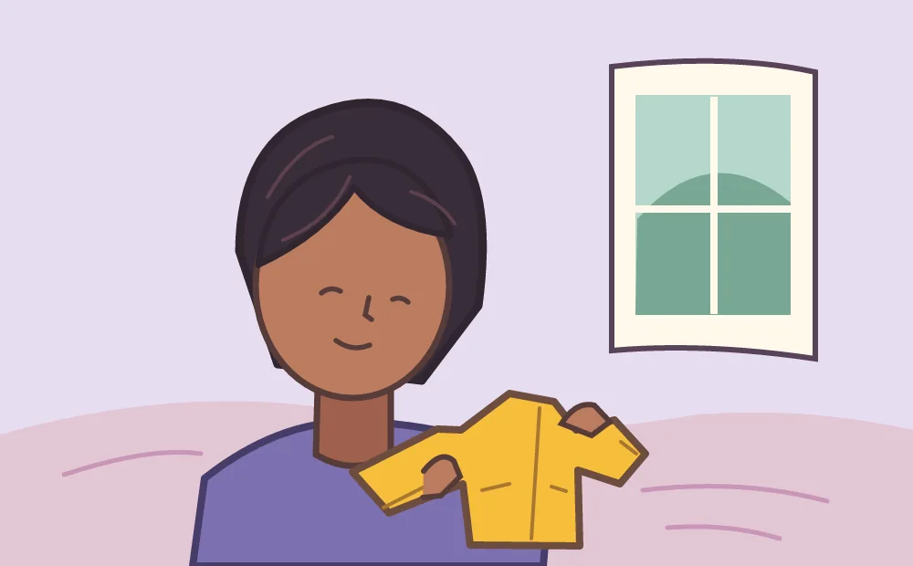

**Objetivo de lectura:** reconocer lo que necesita un personaje y ensayar formas de ofrecer o pedir ayuda en una situación cotidiana.

## Para leer en voz alta

La puerta del patio estaba abierta. Inés buscó su chaqueta amarilla y se metió un brazo. El otro brazo buscó su manga. Había desaparecido.

Inés dio vuelta la chaqueta. Una manga larga apuntaba al suelo. La otra era apenas una arruga.

—¿Te la pongo? —preguntó Dani.

Inés apretó su chaqueta contra el pecho.

—Quiero ponérmela yo.

Dani se sentó a su lado. Afuera, alguien arrastró una silla. Adentro, la manga seguía escondida.

Inés metió los dedos por el agujero. Tocó el puño de la manga, pero cuando tiró, se le vino encima toda la chaqueta.

—¿Me sujetas de aquí? —preguntó. Le mostró a Dani el borde, cerca del cuello.

Dani sostuvo el borde. Inés tiró del puño. Primero asomó un poquito de amarillo. Después salió la manga entera.

—Ya puedes soltar —dijo Inés.

Se puso la chaqueta y alzó los dos brazos. Las dos mangas señalaron el patio.

Dani se levantó. Su gorro se había caído detrás del banco.

Inés se agachó para buscarlo, pero se quedó quieta.

—¿Te lo alcanzo?

—Sí, por favor —dijo Dani—. Desde aquí solo veo el banco.

## Antes y después de la lectura

Muestra una chaqueta con una manga al revés. Lee el inicio y deja que el grupo señale dónde podría estar la manga. Al terminar, vuelve al momento en que Dani sostiene la chaqueta. Pregunta qué hizo cada personaje y cómo supo cuándo soltar.

- **3 años.** Invita a mostrar con un gesto qué parte sostuvo Dani. Ofrece las palabras «ayuda» y «ya está» como posibles expresiones.
- **4 años.** Usa una prenda liviana para representar el diálogo en parejas. Practiquen pedir una acción concreta, como «sostén este lado».
- **5 años.** Conversen sobre la diferencia entre ofrecer ayuda y empezar a ayudar antes de escuchar la respuesta. Inventen otra situación de aula y prueben dos formas de preguntar.

## Qué observar

Anota si alguien identifica una necesidad del personaje o distingue quién hizo cada acción. Durante la dramatización, escucha si aparece una petición específica, una aceptación o una respuesta de espera. Puedes retomar esas expresiones más adelante con la [guía de lenguaje oral en preescolar](/blog/guia-lenguaje-oral-preescolar/).
