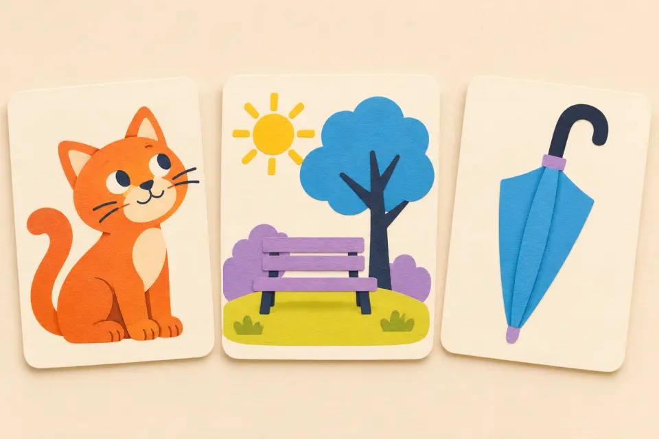

Un gato llega al parque con un paraguas cerrado. ¿Qué puede pasar después? En este juego, cada participante aporta una acción, una palabra o un gesto que continúa la historia. Jueguen en un grupo pequeño para que el cuento avance sin esperas largas.

**Objetivo:** escuchar lo que acaba de pasar en un cuento y sumar una idea que tenga relación con ese momento.

## Materiales

- Tres tarjetas con dibujos de un personaje, un lugar y un objeto. Puedes usar un gato, un parque y un paraguas. Dibuja cada elemento en un papel o usa objetos que los representen.
- Una pelota blanda u otro objeto fácil de pasar que señale el turno. También puedes indicar con un gesto quién sigue.
- Una hoja y un lápiz para anotar o dibujar un momento del cuento si el grupo quiere recordarlo.

## Cómo jugar

1. **Muestra las tres imágenes.** Conversen brevemente sobre lo que aparece en ellas. Empieza con una sola frase que incluya un personaje y un lugar: «Un gato se sentó en un banco del parque».
2. **Haz un turno de ejemplo.** Señala el objeto que faltaba y agrega una acción: «Sintió una gota en la nariz y buscó su paraguas». Entrega la pelota y pregunta «¿qué hizo entonces?». Puedes acompañar la pregunta señalando el paraguas.
3. **Recoge una idea y pásala al siguiente turno.** Si una niña hace un gesto como si abriera el paraguas, cuenta en voz alta la acción que eligió: «El gato abrió el paraguas». Si alguien necesita tiempo, ofrece dos acciones relacionadas con lo que pasó o permite que pase el turno y se sume después. Si surge una idea que parece desconectada, pregunta «¿cómo se encuentra el gato con eso?» y deja que el grupo busque la relación.
4. **Cierren y escuchen su propio cuento.** Tras algunos aportes, pregunta cómo termina. Vuelve a contarlo con las palabras del grupo, mostrando las tarjetas mientras aparecen. Si quieren jugar de nuevo, cambia solo el objeto para ver cómo se transforma la historia.

## Ajustes para cada grupo

- **3 años.** Usa dos imágenes visibles y modela casi todo el relato. Ofrece una elección entre dos acciones concretas, como abrir el paraguas o buscar un techo. Un gesto o un señalamiento es suficiente. La docente pone en palabras el enlace entre ambas acciones.
- **4 años.** Deja las tres imágenes a la vista. Antes de cada aporte, recuerda en una frase lo último que pasó. En el cierre, invita a un niño o una niña a elegir la tarjeta que le ayuda a recordar un momento.
- **5 años.** Invita a alguien del grupo a recordar lo último que pasó antes de continuar. Cuando haya dos finales posibles, prueben ambos oralmente y elijan el que mejor retome una acción anterior.

## Qué observar

Durante una ronda, enfócate en dos o tres participantes y anota qué hicieron y con qué apoyo. Por ejemplo: «Señaló el paraguas al escuchar que empezaba a llover» o «Propuso llevar al gato debajo del árbol para que no se mojara». En otra ronda, observa si pueden retomar la idea anterior con menos ayuda. Puedes aceptar una palabra en la lengua del hogar, un gesto, un dibujo o una seña y confirmar con la persona qué quiso aportar antes de ponerlo en palabras.

Si el grupo quiere llevar su historia al papel, usa la secuencia de [teatro de papel o kamishibai](/cuentos/kamishibai-teatro-de-papel/). Para practicar una intervención oral breve antes de la ronda, prueba [Mensajes de una pista](/juegos/juego-mensajes-de-una-pista/).

## Referencia para docentes

La propuesta de narración oral publicada en Educ.ar trabaja la reconstrucción de un relato con imágenes y la posibilidad de imaginar distintos finales. Este juego lleva esas ideas a una historia original que el grupo construye al escuchar y responder por turnos. [Estrategias para ejercitar la lengua oral en Nivel Inicial](https://cdn.educ.ar/dinamico/UnidadHtml__get__dd650098-7a08-11e1-826f-ed15e3c494af/index.html)
