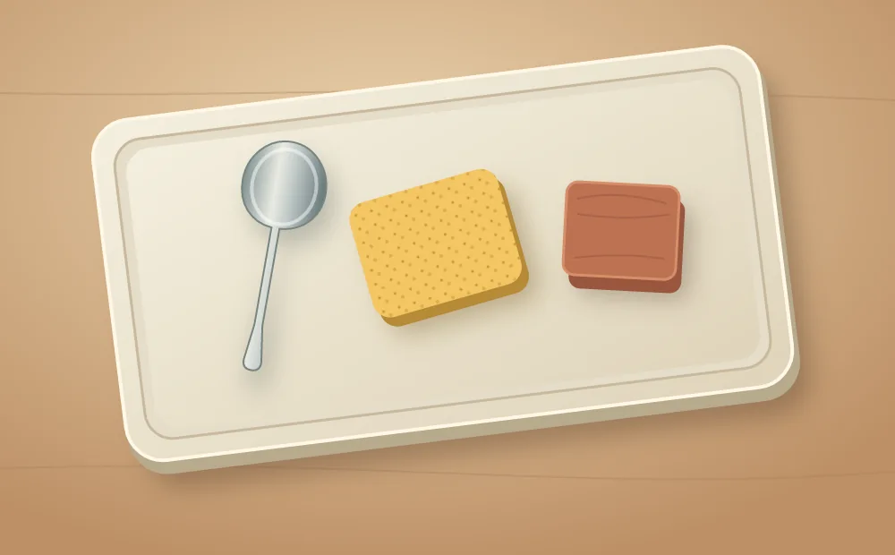

Sobre una bandeja esperan una cuchara grande, una esponja y un bloque. Un paño los cubre unos segundos. Cuando se levanta, falta uno. El grupo puede decir su nombre, señalar una imagen o describir para qué sirve.

**Objetivo:** reconocer un cambio en un conjunto pequeño y compartir una pista que permita comprobar la respuesta.

## Materiales

Prepara una bandeja lisa, un paño opaco y tres objetos grandes y seguros de uso cotidiano. Empieza con piezas diferentes en forma y función. Puedes tener dibujos de los mismos objetos para que todos dispongan de una opción para responder. Si alguien necesita explorar con el tacto, permite que lo haga antes y después de cubrir la bandeja.

## Cómo jugar

1. **Exploren la bandeja.** Da tiempo para tocar o mirar los objetos. Nómbralos con el grupo y comenta un rasgo de cada uno. Acepta nombres de distintas variedades del español o de otras lenguas que se hablen en el aula.
2. **Cubre y retira un objeto.** Mantén el lugar de los demás. Al principio, deja visible la posición vacía y espera a que el grupo compare lo que ve con lo que recuerda.
3. **Comparen las pistas.** Si hay varias respuestas, pide indicar qué uso o forma recordaron. Revela el objeto y comprueba con ellos si corresponde a la pista.
4. **Cambia de rol.** En otra ronda, alguien puede elegir qué objeto esconder y ofrecer una pista si el grupo la necesita. Detén el juego tras pocas rondas o antes si decae el interés.

## Ajustes según la edad

- **3 años.** Presenta dos objetos. Al destapar, ofrece sus dibujos para que puedan señalar el ausente. También puedes mostrar otra pareja idéntica como referencia.
- **4 años.** Usa tres objetos y ofrece una pista de uso si la necesitan.
- **5 años.** Mantén tres o cuatro objetos y pide a la persona que esconde uno que prepare una pista descriptiva sin nombrarlo.

## Qué observar

Registra cómo reconoce el cambio cada participante y qué tipo de apoyo le permite comprobarlo. En una nueva ronda, observa si puede transformar un gesto o un señalamiento en una pista que otra persona entienda.

Si al grupo le interesa construir pistas, continúa con [mensajes de una pista](/juegos/juego-mensajes-de-una-pista/).
