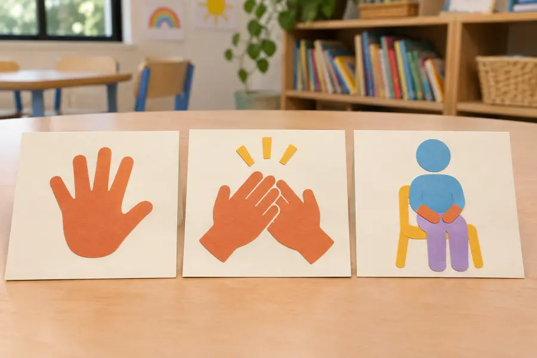

Una palma abierta, una palmada y una pausa pueden formar una secuencia breve. Las tarjetas quedan a la vista para que el grupo pueda volver a mirar el orden mientras juega. Cada participante puede hacer el gesto, señalarlo o mover su tarjeta.

**Objetivo:** representar una secuencia de dos o tres acciones y reconocer cuándo cambia el orden.

## Materiales

- Tres tarjetas con dibujos grandes. Por ejemplo, una mano abierta, dos manos juntas y una persona sentada con las manos sobre el regazo.
- Una mesa baja o un espacio delante del grupo para ordenar las tarjetas. Define desde qué extremo empezarán y marca el inicio con una hoja de color.

## Cómo jugar

1. **Acuerda el gesto de cada tarjeta.** Muestra una por vez. Decide con el grupo cómo representar la pausa. Puede ser quedarse quieto un instante, bajar una mano o señalar la tarjeta.
2. **Arma una secuencia corta.** Coloca dos tarjetas a partir de la marca. Señala la primera, haz el gesto y avanza a la segunda. Da unos segundos para que el grupo lo pruebe a su ritmo.
3. **Cambia el orden.** Pide a una pareja que intercambie las tarjetas y muestre qué gesto sale primero ahora. Invita al resto a comprobarlo mirando desde la marca de inicio.
4. **Construyan otra secuencia.** Un participante ordena las tarjetas y otro la representa o señala. Intercambien los roles. Si olvidan un gesto, deja que miren de nuevo y vuelvan a probar.

## Ajustes para cada grupo

- **3 años.** Usa dos tarjetas con acciones claramente distintas. Señala una a la vez y acompaña con tu propio movimiento. Acepta un gesto o un señalamiento en cada turno.
- **4 años.** Mantén dos tarjetas a la vista al cambiar el orden. Si el grupo puede representar las dos acciones sin ayuda, ofrece la tercera.
- **5 años.** Pide a una pareja que diseñe una secuencia de tres gestos y a otra que la represente. Después cambien una tarjeta de lugar y expliquen qué acción se movió.

## Qué observar

Fíjate si alguien busca la marca de inicio, anticipa qué sigue o vuelve a mirar la tarjeta para corregir el gesto. Al repetir, anota si cambió el orden con ayuda o si pudo explicar el cambio señalando las tarjetas.

Para practicar la repetición de una unidad en otra sesión, prueba la [ficha de patrones y series](/fichas/ficha-patrones-series/). [Juegos para el autocontrol](/juegos/juegos-para-el-autocontrol/) reúne otras propuestas breves con pausas.

## Referencia para docentes

El currículo español de Educación Infantil trabaja la expresión corporal y la interpretación de mensajes en diferentes lenguajes. El apoyo visual de este juego permite comunicar el orden de una serie de acciones. [Real Decreto 95/2022, anexo II](https://www.boe.es/buscar/act.php?id=BOE-A-2022-1654#ai-2)
