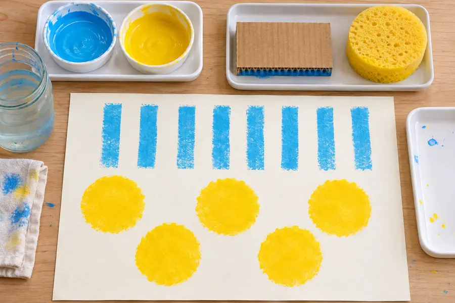

El lado ondulado de un cartón puede dejar líneas y una esponja grande puede dejar un círculo con bordes suaves. En el primer encuentro, el grupo explora qué huella deja cada objeto. En el segundo, elige cómo combinar marcas para hacer una estampa propia.

**Objetivo:** explorar qué marca deja una superficie al presionarla sobre papel y elegir una huella para una composición.

## Materiales

- Hojas gruesas, gotas pequeñas de pintura lavable apta para el aula y bandejas planas.
- Una esponja redonda grande y trozos amplios de cartón ondulado. Cubre los bordes que puedan raspar y revisa que los materiales no se desarmen al mojarlos.
- Papel de prueba y un paño para limpiar. Disponlo todo en una mesa que permita trabajar de pie o sentado.

## Encuentro 1. Probamos las huellas

1. Muestra un objeto seco y pide que observen la zona que tocará el papel. Deja que anticipen si marcará un círculo, rayas u otra forma.
2. Distribuye poca pintura en una bandeja. Presiona el objeto una vez y levántalo sin arrastrar. Deja que cada participante lo pruebe. Si queda un manchón, descarga pintura en un papel de prueba y vuelve a presionar.
3. Pon dos huellas juntas. Pregunta «¿qué objeto dejó esta marca?» y deja que el grupo acerque la pieza, la mire de lado o haga una nueva prueba.

## Encuentro 2. Elegimos y componemos

1. Recupera dos papeles de prueba y recuerda qué objeto corresponde a cada huella.
2. Ofrece una hoja por pareja. Pide que elijan dónde quieren estampar y qué marca usarán. Una opción es hacer un camino de círculos. Otra es poner rayas en un borde y dejar el centro libre.
3. Al final, invita a mostrar una parte del trabajo y contar qué objeto eligieron. Si quieren cambiar algo, ofrece papel para probar una nueva posición o dejar más espacio entre marcas.

## Ajustes según el grupo

- **3 años.** Empieza con una esponja grande y una hoja amplia. Acompaña el movimiento de apoyar y levantar. La elección puede ser dónde dejar la siguiente marca.
- **4 años.** Presenta dos objetos y deja que comparen sus huellas antes de elegir uno para la composición. Pueden señalar la zona que quieren cubrir.
- **5 años.** Invita a girar el cartón y comprobar qué pasa con la dirección de las rayas. Pide que expliquen una decisión mostrando el objeto y su marca.

## Qué observar

Registra si alguien reconoce qué zona del objeto tocó el papel, cambia cómo presiona para obtener una marca más clara o elige un objeto por la huella que deja. Guarda una prueba y una parte de la composición para conversar sobre ese cambio.

Si el grupo quiere explorar otro cambio en el mismo espacio, continúa con la [secuencia de mezcla de colores](/planificaciones/secuencia-mezcla-de-colores/).

## Referencia para docentes

El currículo español de Educación Infantil contempla el uso de materiales, procedimientos y texturas en el lenguaje plástico. Aquí se explora un procedimiento de estampación con objetos cotidianos. [Real Decreto 95/2022, anexo II](https://www.boe.es/buscar/act.php?id=BOE-A-2022-1654#ai-2)
