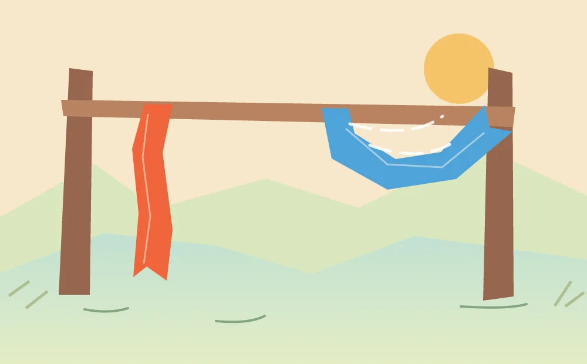

Una cinta colgada puede bastar para empezar una investigación. A veces cuelga quieta y otras veces se levanta. El grupo busca pistas de una misma cosa que no siempre se ve: el aire en movimiento.

**Objetivo:** asociar el movimiento de una cinta con el aire que la alcanza y comunicar una observación con un gesto, un dibujo o una explicación breve.

## Materiales

Prepara dos cintas anchas e iguales de papel liviano, cinta adhesiva y un cartón rígido del tamaño de una libreta para abanicar. Fija las cintas por un extremo a soportes estables y mantenlas separadas de las caras. Puedes elegir un espacio protegido como un pasillo si el patio no está disponible.

## Encuentro 1. Buscar pistas

1. Coloca una cinta en un punto protegido y otra cerca de un lugar donde circule aire. Obsérvenlas durante un momento sin tocarlas. ¿Cuál se mueve ahora? Puedes acompañar la pregunta mostrando ambas ubicaciones.
2. Cambien de lugar si se puede hacer con seguridad. Miren si el movimiento siempre es igual y qué pasa cuando hay una pausa. Si el día está calmo, registren las dos cintas quietas y vuelvan a mirar después.
3. En el aula, dibuja las dos posiciones que hayan observado. Pide al grupo que señale cuál vio y que proponga dónde volver a colocar una cinta.

## Encuentro 2. Hacer una prueba

1. Sitúa una cinta frente al grupo con el extremo fijo visible. Muestra el cartón quieto y pregunta qué podría cambiar si lo mueves.
2. Abanica desde un lado sin tocar la cinta y detente. Repite alternando movimiento y pausa. Usa el mismo cartón y la misma cinta para que se pueda comparar lo que cambia.
3. Registra dos momentos en un papel grande. Anota qué hizo el cartón y qué hizo la cinta. Vuelve a probar una idea del grupo antes de cerrar.

## Ajustes según la edad

- **3 años.** Mira una sola cinta y alterna una pausa y un movimiento. Ofrece imitar con la mano lo que vieron.
- **4 años.** Pide anticipar qué ocurrirá al empezar a abanicar y elige entre dos dibujos para registrar el resultado.
- **5 años.** Invita a decidir qué mantener igual en una segunda prueba y a explicar la relación entre el cartón, el aire y la cinta.

## Qué observar

Registra si la persona reconoce el momento de cambio y si señala una acción que pudo producirlo. Guarda un dibujo o la frase exacta que empleó y retómala al comparar observaciones con el [proyecto de exploración al aire libre](/planificaciones/proyecto-exploradores-al-aire-libre/).

El currículo español de Infantil propone anticipar y comprobar ideas a partir de fenómenos del entorno. [Real Decreto 95/2022, anexo II](https://www.boe.es/buscar/act.php?id=BOE-A-2022-1654#ai-2).
