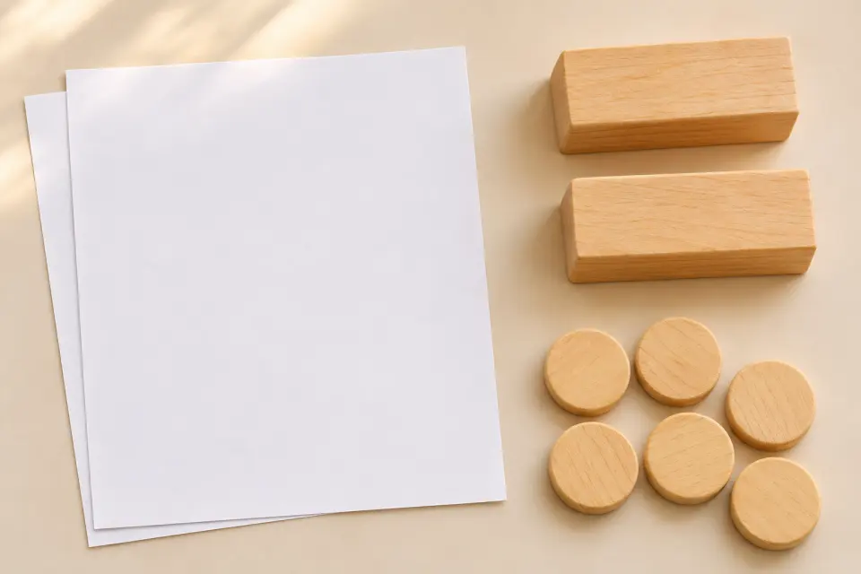

Dos hojas iguales pueden comportarse de forma distinta cuando una queda plana y la otra se pliega. En esta planificación el grupo construye puentes pequeños, repite una prueba con apoyos a la misma distancia y dibuja la forma que puso a prueba.

**Objetivo:** comparar dos construcciones hechas con el mismo papel y usar lo observado para explicar qué cambió al modificar la forma.

## Materiales y preparación

- Dos hojas del mismo tipo y tamaño por grupo, dos bloques anchos iguales y varias piezas de madera grandes, lisas y del mismo tamaño.
- Cinta de papel para marcar dónde van los bloques, una hoja para registrar y crayones.
- Una mesa despejada. Deja un espacio entre los bloques que ambas hojas puedan cubrir. Prueba el montaje antes de la clase y ajusta la separación o el papel si las dos formas reaccionan igual con las piezas disponibles.

## Encuentro 1. ¿Qué ocurre con una hoja plana?

1. Coloca la hoja sobre los dos bloques. Pide que señalen qué zona no tiene apoyo debajo.
2. Invita a colocar una pieza en el centro. Si la hoja baja sin tocar la mesa, agrega otra pieza y detén la prueba cuando ocurra lo que definieron como caída, por ejemplo, que el papel toque la mesa o la pieza caiga.
3. Pide a un grupo que dibuje el montaje y dicte qué sucedió. Para los grupos de 4 años basta con registrar qué ocurrió con una pieza. Los grupos de 5 pueden contar cuántas quedaron sostenidas antes de la caída.

## Encuentro 2. Cambiamos la forma del papel

1. Vuelve a poner los bloques en las marcas. Pliega la otra hoja en acordeón y oriéntala de modo que los pliegues recorran el espacio de un bloque al otro. Apoya ambos extremos y ubica la primera pieza en el centro.
2. Pide que anticipen qué pasará y repite la prueba con las mismas piezas, en el mismo lugar. Si las piezas se caen hacia un costado, recupera la posición central y prueba otra vez.
3. Miren los dos registros. Pregunta «¿qué cambiamos?» y «¿qué observamos?». Si los resultados fueron parecidos, deja que lo registren y elijan una prueba posterior. Por ejemplo, ensayar con otro ancho de pliegue manteniendo la misma separación.

## Ajustes según la edad

- **3 años.** Muestra las dos formas ya preparadas. Coloca una sola pieza sobre cada una mientras el grupo observa y señala qué pasó. Puedes nombrar «plano» y «plegado» a medida que muestras cada hoja.
- **4 años.** Prepara el acordeón o ayuda a doblar. Da un turno para colocar la primera pieza y otro para dibujar la forma del puente. Retomen el resultado con dos dibujos.
- **5 años.** Invita a controlar la separación usando las marcas y a registrar con un punto cada pieza sostenida. Pide que expliquen qué se mantuvo igual y que propongan un cambio para probar después.

## Qué observar

Anota si alguien reconoce que se cambió la forma de la hoja, vuelve a colocar un bloque en su marca o señala el registro para explicar el resultado. Una pregunta como «¿qué hacemos para comparar otra vez?» ayuda a ver si relaciona el resultado con la manera en que se hizo la prueba.

Puedes usar la [secuencia Medimos con bloques](/planificaciones/secuencia-medimos-con-bloques/) para explorar cómo registrar la separación entre apoyos.

## Referencia para docentes

El currículo español de Educación Infantil incluye ensayar, observar y comprobar ideas para conocer los materiales. En esta planificación, esas acciones se trabajan mediante dos montajes comparables. [Descubrimiento y exploración del entorno](https://educagob.educacionfpydeportes.gob.es/curriculo/curriculo-lomloe/menu-curriculos-basicos/ed-infantil/areas/descubrimiento/criterios-evaluacion-segundo-ciclo.html)
