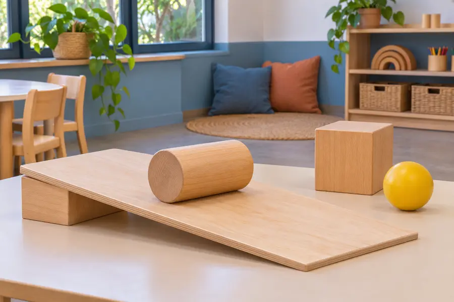

Una pelota gira al bajar por una rampa. Un cubo puede bajar deslizándose o quedarse quieto. ¿Qué hará un cilindro cuando lo apoyamos primero de lado y luego sobre una base? Esta secuencia propone mirar cómo se mueve cada objeto, con tiempo para anticipar y repetir.

**Objetivo:** distinguir entre rodar, deslizarse y quedar quieto, y observar cómo cambia el movimiento del mismo objeto según la cara que se apoya.

## Materiales y preparación

- Una tabla corta y liviana o un cartón rígido, un bloque bajo para sostener un extremo y cinta para fijar el montaje.
- Una pelota blanda, un cubo y un cilindro ancho de bordes redondeados. Elige piezas grandes que puedan manipularse con facilidad.
- Cinta de color para la marca de salida, papel y crayones.

Monta la rampa sobre el suelo o una mesa baja y estable. Deja una zona despejada al final. Prueba la inclinación con el cilindro acostado y comprueba que la rampa no se mueva. Incluye la opción «se quedó quieto» para registrar cualquier resultado.

## Encuentro 1. Miramos cómo baja

1. Coloca la pelota en la marca y suéltala sin empujar. Invita a señalar qué parte mira al grupo antes y después de avanzar. Si cuesta ver el giro, pon una marca de papel bien adherida en una pelota de superficie lisa.
2. Prueba con el cubo y con el cilindro acostado desde la misma marca. Cada participante puede anticipar con un gesto, luego comprobar mirando qué ocurrió. Enseña «rueda» con un movimiento circular de las manos y «se desliza» con una mano que avanza.
3. Dibuja un objeto y anota junto a él lo que el grupo observó. Si el cubo no baja, registra que quedó quieto en esa prueba. Repítela cuando varias personas hayan visto resultados distintos.

## Encuentro 2. Usamos el mismo cilindro

1. Recuperen la marca de salida. Coloca el cilindro sobre su base plana. Pregunta qué creen que pasará y suéltalo. Si se inclina o cambia de orientación al bajar, describan esa acción.
2. Repite con el cilindro acostado y mantén la misma rampa y marca. Comparen el movimiento antes de cambiar de objeto.
3. Pide a cada pareja que dibuje cómo estaba apoyado el cilindro y explique con palabras o señas qué diferencia pudo ver.

## Ajustes según la edad

- **3 años.** Haz dos demostraciones breves, una con una pelota y otra con un cubo, y deja que señalen cuál giró. Registra tú lo que vieron en una hoja común.
- **4 años.** Pon dos objetos a la vista y acompaña el gesto de soltar. Pide una descripción breve de lo que pasó antes de presentar el cilindro en otra posición.
- **5 años.** Pide a una pareja que mantenga la marca y a otra que compruebe si el cilindro cambia de movimiento al colocarlo de otra forma. Deja que propongan una repetición si el resultado generó dudas.

## Qué observar

Anota si alguien mira el giro, distingue deslizamiento de reposo o muestra con sus manos cómo apoyó el cilindro. Pregunta qué se mantuvo igual durante la prueba, con el material a la vista.

La [colección de experimentos sencillos para inicial](/actividades/experimentos-sencillos-nivel-inicial/) reúne otras comparaciones breves a partir de materiales del aula.

## Referencia para docentes

El currículo español de Educación Infantil contempla la observación y la comprobación de ideas sobre objetos y materiales. La secuencia propone dejar fija la rampa y probar el mismo cilindro en distintas posiciones. [Real Decreto 95/2022, anexo II](https://www.boe.es/buscar/act.php?id=BOE-A-2022-1654#ai-2)
